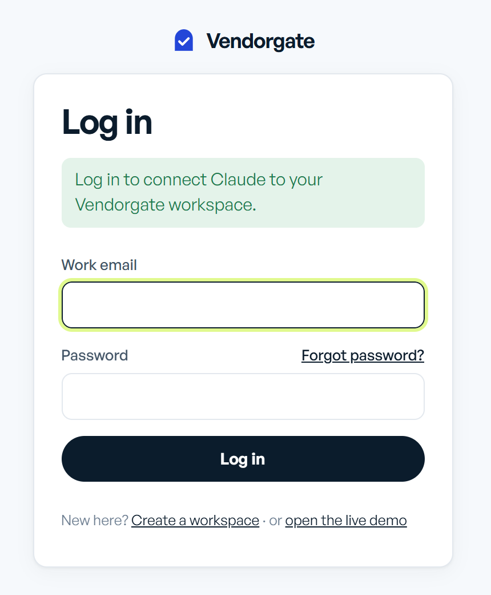
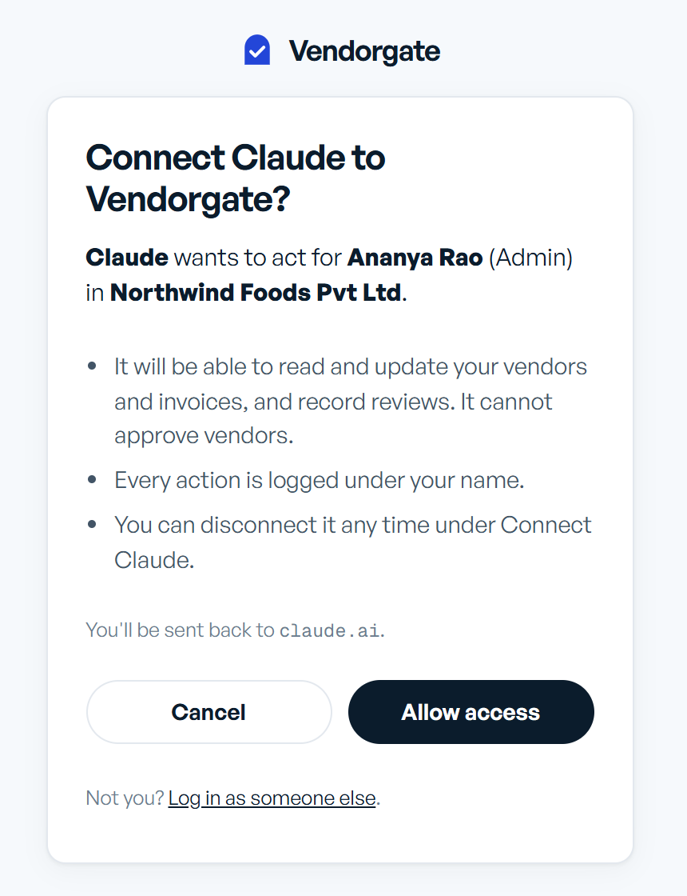
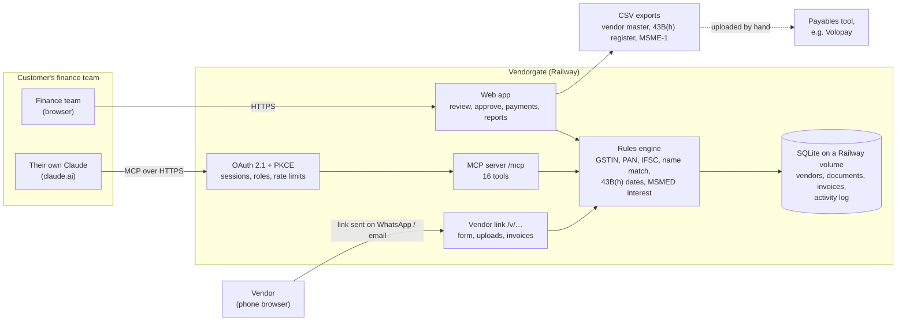
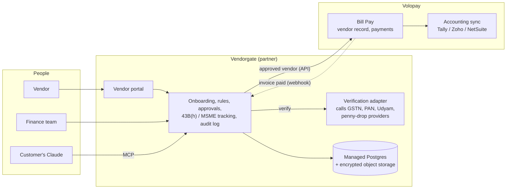

# Vendorgate

**Vendor onboarding for Indian finance teams that runs on your own Claude.** Vendorgate collects a vendor's PAN, GST, bank and MSME details through a link the vendor fills in. It checks every number against fixed rules and has a person approve. It then tracks the Section 43B(h) payment deadline on every invoice that vendor sends.

*Volopay pays your vendors. Vendorgate makes them payable.*

| | |
|---|---|
| **Live app** | https://vendorgate-production-3ec4dac7.up.railway.app (click **Try the live demo**, no password needed) |
| **MCP link** | `https://vendorgate-production-3ec4dac7.up.railway.app/mcp` ([how to connect](#connect-to-claude)) |
| **Step-by-step guide** | [docs/USAGE.md](docs/USAGE.md) |
| **Product document** | [docs/PRODUCT.md](docs/PRODUCT.md): the problem, why Claude alone isn't enough, security, business model |

---

## Connect to Claude

**MCP link:** `https://vendorgate-production-3ec4dac7.up.railway.app/mcp`

1. In **claude.ai**, open **Settings → Connectors** and click **Add custom connector**.
2. Name it **Vendorgate**, paste the MCP link above, and click **Add**.
3. Click **Connect**. A Vendorgate sign-in page opens: click **open the live demo** (no password needed), or log in to your own workspace.

   

4. Click **Allow access**. Claude can read and update vendors and invoices, but it can never approve a vendor.

   

5. In a new chat, open the tools menu, switch **Vendorgate** on, and try:

   > We're starting to buy corrugated boxes from Sharma Packaging. Contact is Rakesh Sharma, rakesh@sharmapack.in, +91 98201 44556. 30-day terms, signed agreement. Onboard them in Vendorgate.

The same MCP link is shown in the app under **Connect Claude**. Full walkthrough with more screenshots: [docs/CONNECT.md](docs/CONNECT.md). All demo data is fictional.

---

## 1. What I built (live today)

One web service, deployed on Railway. It has no AI inside: the customer's own Claude does the reading and writing through MCP, and Vendorgate keeps the record, runs the rules and holds the approval.

*Image version: [docs/diagrams/built-architecture.png](docs/diagrams/built-architecture.png)*

### Data flow

1. **Invite.** Finance asks Claude to onboard a vendor. Claude calls `invite_vendor`, and Vendorgate creates the vendor record and a unique link. Claude writes the invite message, and finance sends it on WhatsApp or email.
2. **Collect.** The vendor opens the link on their phone, types their details and uploads document photos. Photos are resized in the browser. The same rules run in the browser (instant feedback) and on the server (the source of truth). Submitting locks the link.
3. **Review.** Finance asks Claude to review. `read_vendor_documents` returns the document images next to what the vendor typed. Claude compares them and saves its findings with `record_review`. It can fix provable typos, but never bank details or names.
4. **Approve.** A person approves, rejects or asks for changes in the web app. Claude cannot approve.
5. **Invoices.** Approved vendors send invoices on the same link. Claude checks them with `read_invoice`, and a person or Claude accepts or disputes them. Acceptance starts the 43B(h) clock.
6. **Pay and report.** The payments page and `payments_due` show what's due and any MSMED Act interest. Finance marks invoices paid, and the year-end reports and vendor master are exported as CSVs.

Every step writes to an activity log under the acting person's name, including actions Claude takes on their behalf.

---

## 2. Proposed production system (with Volopay)

In production, Vendorgate becomes the onboarding step in front of Volopay Bill Pay. The manual CSV hand-off is replaced by an API sync, and format checks are backed by live verification.

*Image version: [docs/diagrams/proposed-architecture.png](docs/diagrams/proposed-architecture.png)*

### Who owns what

| Area | Volopay | Vendorgate (partner) | Customer |
|---|---|---|---|
| Vendor self-onboarding link, document collection | | ✓ | |
| Format checks (GSTIN, PAN, IFSC, name match, duplicates) | | ✓ | |
| Live verification (GSTN, PAN, Udyam, penny-drop) | Could supply, if it already has these checks | ✓ calls the providers | |
| Reading documents, drafting messages | | | ✓ their own Claude |
| Approving a vendor | | Holds the approval record | ✓ a person in finance |
| Vendor master of record | ✓ once synced | ✓ before approval | |
| Bank detail changes after approval | Blocks payouts until re-approved | ✓ sends the vendor back to review | ✓ re-approves |
| Paying the vendor, payment approvals, card and bank rails | ✓ | | |
| 43B(h) clock, MSMED interest, MSME-1 and 43B(h) reports | | ✓ | |
| Payment status (paid date) | ✓ source | ✓ consumes it, via webhook | |
| Accounting / ERP sync | ✓ | | |
| Customer and vendor support | Payments | Onboarding and compliance | |

---

## 3. Built vs proposed

| | Built (live) | Proposed (production) |
|---|---|---|
| Hosting | One Railway container | Multiple instances behind a load balancer, separate staging |
| Database | SQLite file on a Railway volume | Managed Postgres with point-in-time recovery |
| Documents | Stored as blobs in SQLite | Encrypted object storage (e.g. S3), signed URLs, retention policy |
| Verification | Format and checksum rules; IFSC bank name looked up from a built-in table of bank codes | Live GSTN, PAN, Udyam and penny-drop checks |
| Hand-off to Volopay | CSV export, uploaded by hand | Vendor API sync, plus a paid-status webhook back |
| Payment status | Marked paid by hand or through Claude | Pulled automatically from Volopay |
| Email | Code ready (SMTP); not configured on the live app, so links are shared by WhatsApp or copied | Transactional email provider with SPF/DKIM |
| Sign-in | Email and password, OAuth 2.1 for Claude, 3 roles | Plus SSO (Google / Microsoft), 2FA, and possibly sign-in through Volopay |
| Approvals | One approver | Approval rules (amount, category, second approver) |
| Entities | One company per workspace | Multiple entities (Business plan) |
| Monitoring | Health check and Railway logs | Error tracking, uptime alerts, audit-log export |
| Testing | 102 end-to-end checks, run by hand | Run on every change in CI |

---

## 4. Tools used

- **Runtime:** Node.js 24, Express 4, SQLite (built-in `node:sqlite`), server-rendered HTML with no front-end framework.
- **Claude integration:** Model Context Protocol (MCP) TypeScript SDK: Streamable HTTP transport and its OAuth 2.1 auth router (dynamic client registration, PKCE). Zod for tool input schemas.
- **Security:** scrypt password hashing, `express-rate-limit`, HttpOnly SameSite cookies, Origin checks on form posts.
- **Email:** Nodemailer (SMTP), ready but not configured on the live app.
- **Hosting:** Docker on Railway with a persistent volume.
- **Testing:** two end-to-end suites over HTTP and MCP (43 product checks and 59 sign-in and access checks).
- **Sample data:** fictional vendor documents rendered with resvg, all marked SAMPLE.
- **Built with:** Claude Code.

---

## 5. Assumptions

- The customer has a Claude plan that supports custom connectors. Vendorgate pays no AI costs.
- Vendors can open a link on a smartphone and photograph their documents.
- 43B(h) as implemented: micro and small enterprises are paid within 15 days of acceptance, or within the agreed term capped at 45 days if there's a written agreement. A pending invoice counts from its invoice date until someone accepts it (deemed acceptance, the cautious assumption).
- MSMED Act interest: compound with monthly rests, at 3× the RBI bank rate, which the customer enters in Settings.
- Volopay (or another payables tool) would accept vendor records through an API. Today the hand-off is a CSV, and I haven't confirmed any Volopay partner API.
- Data size is small: about 1 MB of documents per vendor.

## 6. Limitations

- **No live verification.** A GSTIN or PAN that passes the format and check-digit rules may still not exist. A valid IFSC doesn't prove that the account belongs to the vendor. Claude's document reading and a human approval are the safeguards today.
- **No Volopay integration.** Approved vendors leave as a CSV, and payment status doesn't flow back automatically.
- **Single instance.** SQLite on one volume, with documents stored in the database. Fine for a pilot, not for scale, and there's no backup and restore process yet.
- **No email on the live app.** Invites are shared by WhatsApp or copied links. Password-reset and invite emails go to the server log.
- **Document reading depends on the customer's Claude.** Quality depends on photo quality and the customer's Claude plan.
- **Compliance output is a reminder, not tax advice.** The rules follow my reading of 43B(h) and the MSMED Act and should be reviewed by a chartered accountant.
- **Shared demo.** Everyone using the demo sees the same data. It resets nightly, and password, email and team changes are switched off.

## 7. Next steps

1. **Volopay hand-off.** Push approved vendors to Bill Pay through an API, and take paid status back by webhook so the 43B(h) clock closes itself.
2. **Live verification.** Add GSTN, PAN, Udyam and bank penny-drop checks through a verification provider, and show the results next to the existing rules.
3. **Production data layer.** Move to Postgres and encrypted object storage, with backups, retention rules and a staging environment.
4. **Email and reminders.** Switch on transactional email, and remind vendors who haven't finished and finance teams about upcoming MSME deadlines.
5. **Approval rules and multiple entities** for the Business plan.
6. **Pilot** with 3–5 CA firms, measuring time to onboard a vendor, errors caught before payment, and 43B(h) deadlines met.
