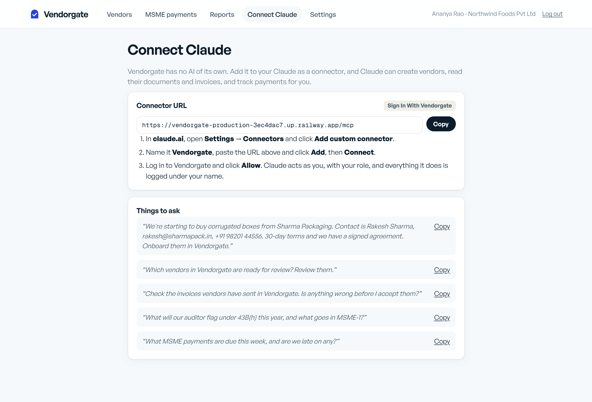
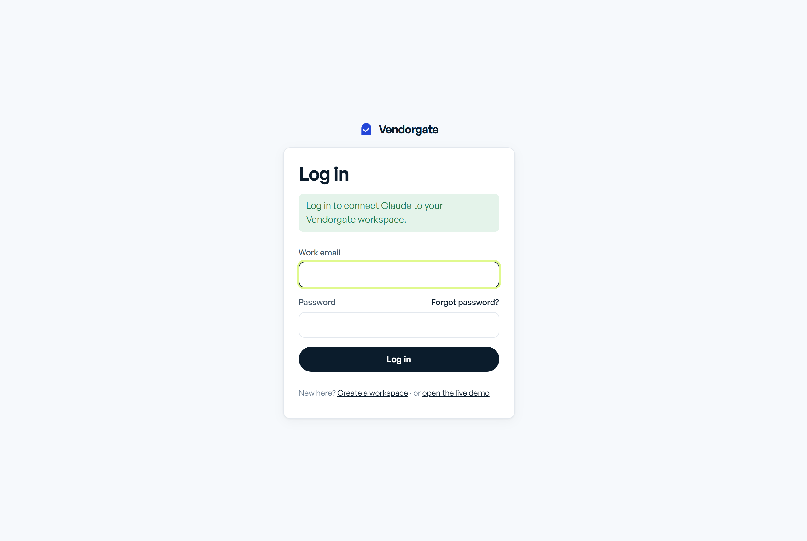
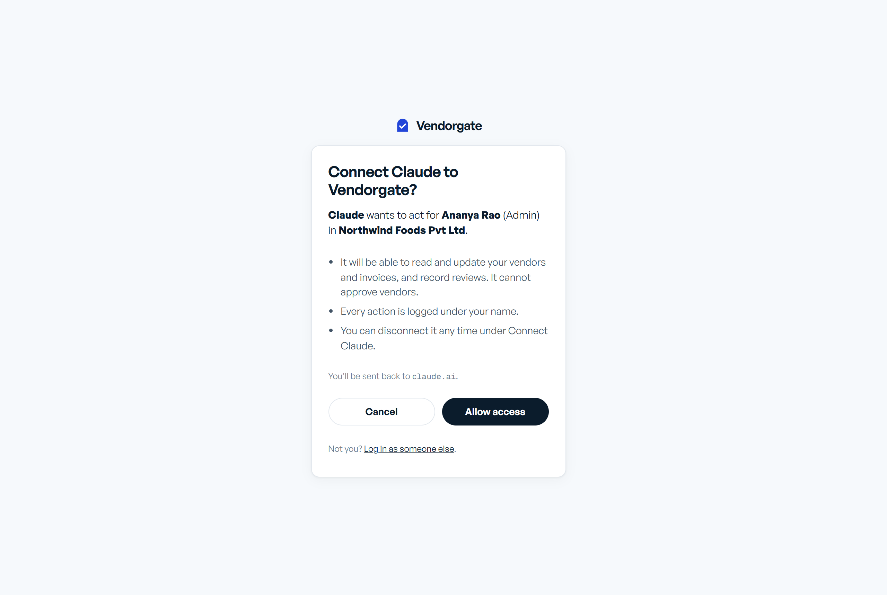

# Connect Vendorgate to Claude

Live app: https://vendorgate-production-3ec4dac7.up.railway.app

**1. Copy the connector URL.** In Vendorgate, open **Connect Claude** in the top menu. The URL is `https://vendorgate-production-3ec4dac7.up.railway.app/mcp`.

**2. Add it in claude.ai.** Open **Settings → Connectors → Add custom connector**. Name it **Vendorgate**, paste the URL, then click **Add** and **Connect**.

**3. Sign in.** Claude opens the Vendorgate sign-in page. Log in to your workspace, or click **open the live demo** to use the sample company.

**4. Allow access.** Check the workspace and role, then click **Allow access**. Claude can read and update vendors and invoices, but it can never approve a vendor. Every action is logged under your name.

**5. Try it.** In a new Claude chat, switch Vendorgate on from the tools menu and ask:

> We're starting to buy corrugated boxes from Sharma Packaging. Contact is Rakesh Sharma, rakesh@sharmapack.in, +91 98201 44556. 30-day terms, signed agreement. Onboard them in Vendorgate.

Everything in the demo is fictional: the company, the vendors, the people and the documents. The demo workspace is shared and resets every night.
